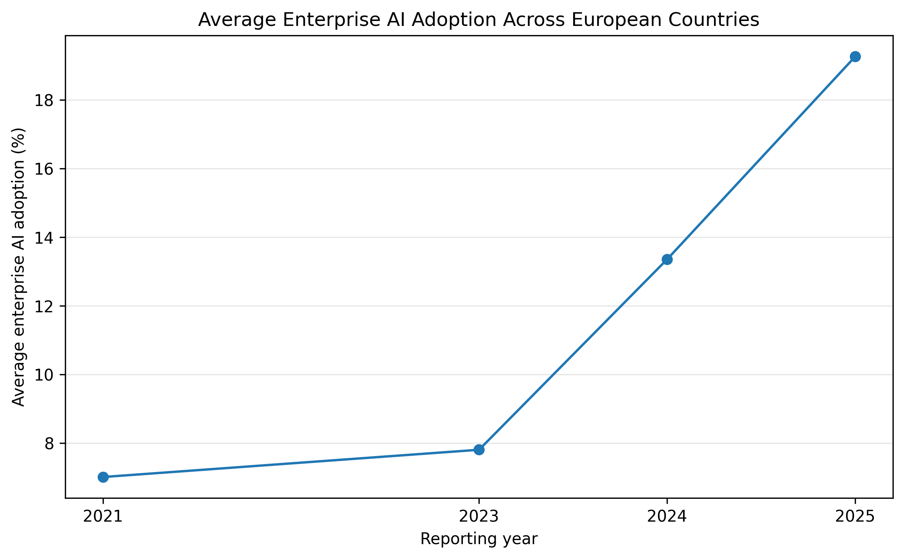
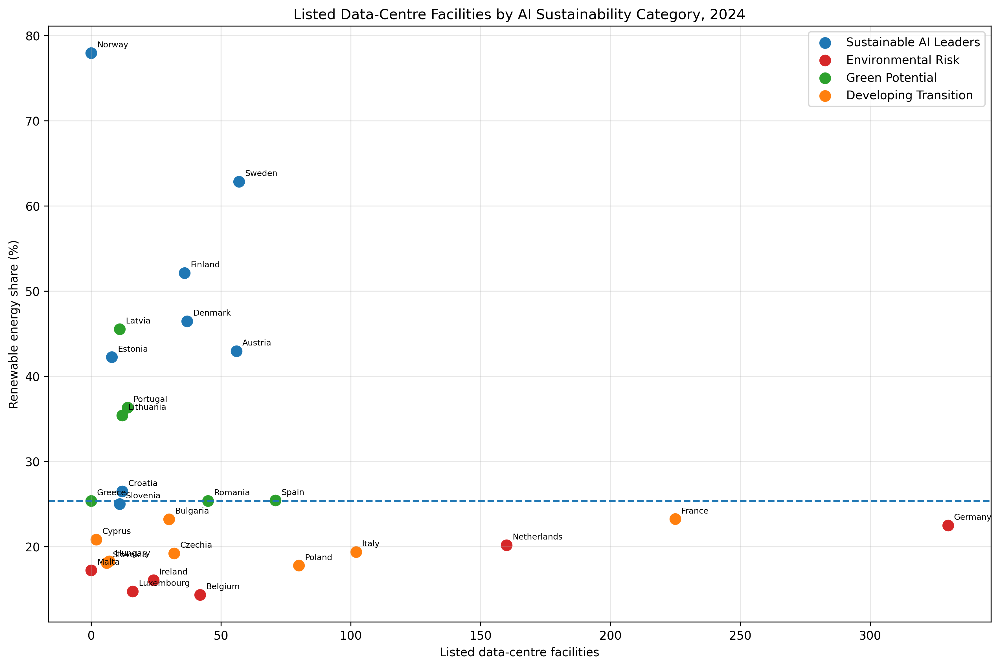
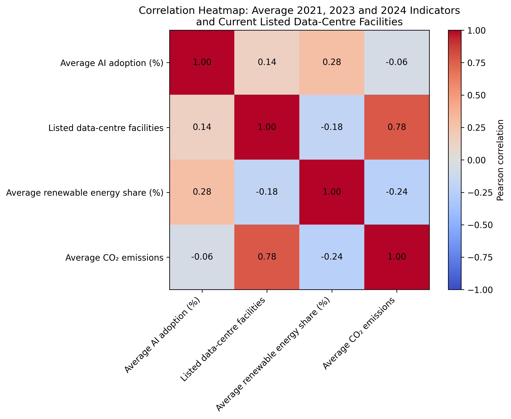

# Europe's AI Growth & Environmental Sustainability
### A Python Data Integration and Exploratory Analysis Project

**Python | pandas | Data Wrangling | API Integration | Exploratory Data Analysis | Data Visualization**

*Ironhack Data Analytics Bootcamp | Collaborative Project | 2026*

## Project Summary

As artificial intelligence adoption accelerates across Europe, how does that growth relate to renewable energy, national emissions, and data-centre infrastructure?

This project integrates publicly available European datasets to investigate relationships between enterprise AI adoption, renewable-energy share, CO₂ emissions from energy industries, and listed data-centre facilities.

Using Python and pandas, we prepared and combined data from Eurostat and PeeringDB, aligned country-level indicators, explored trends, and developed visualizations to compare environmental and technological conditions across European countries.

**The objective was to identify meaningful patterns in the available data, not to establish that AI adoption causes emissions or to calculate AI's environmental footprint.**

### What This Project Demonstrates

- **Data acquisition:** Retrieving structured data from the Eurostat API.
- **Data cleaning:** Standardizing country identifiers, reporting years, and analytical fields.
- **Data integration:** Combining datasets with different structures, coverage, and reporting periods.
- **Exploratory data analysis:** Comparing national indicators, examining trends, and calculating correlations.
- **Data visualization:** Communicating relationships through country comparisons, trend charts, and correlation matrices.
- **Analytical judgment:** Identifying limitations, interpreting associations responsibly, and distinguishing correlation from causation.

## My Role and Contributions

This was a collaborative project completed with **Aline and Sandra** during the Ironhack Data Analytics Bootcamp.

**My primary responsibility was developing the integrated Python analysis and bringing the separate datasets together into a common analytical framework.**

My contributions included:

- Retrieved and prepared enterprise AI-adoption data through the Eurostat API.
- Developed the main Python/Jupyter analytical workflow using pandas.
- Integrated cleaned datasets contributed by teammates.
- Standardized country and year identifiers to support cross-source comparisons.
- Merged AI adoption, renewable-energy, emissions, and data-centre indicators.
- Reviewed data consistency, country coverage, and missing-value considerations.
- Developed comparative analyses, visualizations, and investigations of relationships between indicators.
- Contributed to the interpretation and presentation of the group's findings.

My teammates contributed source-specific cleaning, exploratory work, and the collaborative presentation. Their original notebooks are preserved in the repository to maintain transparency about the project's development.

### Start Here

| Resource | Description |
| --- | --- |
| **[Main Analysis Notebook](Kyle%27s%20notebook%5Bmain%20notebook%5D.ipynb)** | My primary Python workflow, including AI-adoption preparation, dataset integration, exploratory analysis, and visualizations |
| [Integrated Dataset](merged_data.csv) | Country-year dataset used in the analysis |
| [Correlation Matrix](correlation_matrix_2024.png) | Visual summary of relationships between the main indicators |
| [Project Conclusion (PDF)](Is%20Europe%27s%20AI%20boom%20environmentally%20sustainable_%20EDA%20Conclusion%20%281%29.pdf) | Collaborative interpretation of the findings |

**For a technical review, begin with the Main Analysis Notebook.** The sections below explain the research question, analytical methodology, findings, and limitations.

---

## Research Question and Scope

**Is Europe's AI boom developing alongside energy conditions that could support more sustainable growth?**

We investigated several related questions:

1. How has enterprise AI adoption changed across European countries?
2. Do countries with higher AI adoption also have higher renewable-energy shares?
3. How do listed data-centre facilities relate to national energy conditions?
4. What relationships exist between renewable-energy share and CO₂ emissions from energy industries?
5. What can these indicators tell us about the environmental context of AI growth, and where are the limits of the available evidence?

### Project at a Glance

| Aspect | Details |
| --- | --- |
| **Geographic scope** | European countries represented in the available datasets; PeeringDB extraction targeted EU27 countries |
| **AI adoption coverage** | 2021, 2023, 2024, and 2025 |
| **Energy data coverage** | Through 2024 |
| **Data-centre coverage** | Directory snapshot, not a historical time series |
| **Primary sources** | Eurostat and PeeringDB |
| **Methods** | API acquisition, cleaning, normalization, merging, exploratory analysis, visualization, and correlation analysis |
| **Deliverables** | Jupyter notebooks, cleaned datasets, integrated analytical data, visualizations, and a team presentation |

---

## Key Findings

Our analysis suggested that **AI adoption alone is not a reliable indicator of environmental sustainability**.

### 1. Enterprise AI Adoption Increased

Reported enterprise AI adoption rose substantially across the available reporting years, particularly in the later observations.

However, adoption patterns differed between countries, and technological growth did not necessarily correspond to similar energy conditions.

### 2. AI Adoption and Renewable Energy Did Not Show a Consistent Relationship

Countries with relatively high enterprise AI adoption had different renewable-energy shares.

Higher AI adoption did not consistently coincide with higher renewable-energy use.

This suggests that technological adoption and national energy transition progress should be examined as separate dimensions.

### 3. Data-Centre Presence Varied Across Energy Conditions

Listed data-centre facilities appeared in countries with different renewable-energy profiles.

The number of listed facilities did not show a simple relationship with renewable-energy share.

Importantly, facility counts measure directory listings, not electricity consumption, computing capacity, or AI-specific infrastructure use.

### 4. Data-Centre Counts and Power-Sector Emissions Showed an Association

Among the country-level relationships examined, listed data-centre facility counts showed the strongest positive association with average CO₂ emissions from energy industries.

**This is a descriptive statistical relationship, not evidence that data centres caused the observed emissions.**

National economic activity, industrial structure, population, and electricity demand may influence both variables.

### 5. Renewable Energy and Emissions Showed a Modest Negative Association

Renewable-energy share showed a modest negative relationship with average power-sector CO₂ emissions.

Average AI adoption, meanwhile, showed little observed relationship with those emissions.

### Overall Interpretation

**Europe's AI growth cannot be evaluated environmentally through AI adoption rates alone.**

Understanding the sustainability of digital infrastructure requires additional information about electricity generation, actual data-centre energy consumption, computing workloads, and national economic conditions.

The analysis provides a basis for further investigation rather than a causal assessment of AI's environmental impact.

---

## Selected Visualizations

### 1. Enterprise AI Adoption Over Time

The selected Eurostat series includes enterprise AI-adoption observations for **2021, 2023, 2024, and 2025**.

The missing 2022 observation was not interpolated.



### 2. AI Adoption, Renewable Energy, and Data-Centre Presence

We grouped countries using median-based categories for AI adoption and renewable-energy share.

This allowed us to compare listed data-centre facilities across countries with different technological and energy profiles.

The chart colors represent the AI/renewables category, not the magnitude of data-centre energy consumption.



### 3. Correlation Analysis

We examined country-level associations between AI adoption, renewable-energy share, CO₂ emissions from energy industries, and listed data-centre facilities.

The correlation matrix summarizes relationships in the available country sample.

**Correlation coefficients do not establish causation.**



### Additional Visualizations

- [AI Adoption by Country](ai_adoption_2024_top10.png)
- [Data Centres vs. Renewable Energy](data_center_vs_renewable_energy_2024.png)
- [Data Centres vs. Emissions](data_center_vs_emissions_2024.png)

---

## Data Sources and Definitions

The project combines indicators from multiple publicly available sources.

| Indicator | Source | Definition and Interpretation |
| --- | --- | --- |
| **Enterprise AI Adoption** | Eurostat SDMX API (`ISOC_EB_AI`) | Share of enterprises using at least one AI technology, based on the selected series for firms with 10+ employed persons |
| **Renewable-Energy Share** | Eurostat | Country-year percentage of energy from renewable sources |
| **Power-Sector CO₂ Emissions** | Eurostat (`CRF1A1`) | CO₂ emissions from fuel combustion in energy industries; not AI-specific emissions |
| **Data-Centre Facilities** | PeeringDB Facilities API | Count of listed facilities by country; not measured electricity consumption or computing capacity |
| **Electricity Prices** | Eurostat (`nrg_pc_204`) | Explored during development but excluded from the final comparison because price does not directly measure generation, demand, or emissions |

### Source References

- [Eurostat Enterprise AI Adoption API](https://ec.europa.eu/eurostat/api/dissemination/sdmx/3.0/data/dataflow/ESTAT/ISOC_EB_AI/1.0)
- [PeeringDB Facilities API](https://www.peeringdb.com/api/fac)

---

## Analytical Methodology

### Step 1 — Data Acquisition and Preparation

Enterprise AI-adoption data were retrieved from the Eurostat API.

The analysis also incorporated cleaned Eurostat renewable-energy and emissions data and PeeringDB facility records.

Source-specific preparation included:

- Selecting relevant indicators and reporting periods.
- Standardizing country identifiers.
- Aligning year fields and analytical variables.
- Preparing numerical measures for comparison.
- Aggregating data-centre facility listings to the country level.

The source datasets differed in structure, coverage, and reporting periods, requiring additional attention during integration.

### Step 2 — Dataset Integration

The cleaned sources were combined using country identifiers (`geo`) and reporting years where applicable.

The resulting analytical dataset included:

| Field | Description |
| --- | --- |
| `geo` | Country identifier |
| `year` | Reporting year |
| `country_name` | Readable country name |
| `ai_adoption_pct` | Enterprise AI-adoption percentage |
| `renewable_energy_share` | Renewable-energy share |
| `emissions` | CO₂ emissions from energy industries |
| `datacenters` | Count of matched PeeringDB facility listings |

During integration, we reviewed country-year duplication, differences in geographic coverage, and missing values.

**Data-centre facility counts were joined as a snapshot rather than treated as a historical series.**

### Step 3 — Exploratory Data Analysis

The integrated data supported several analyses:

- Changes in enterprise AI adoption across reported years.
- Country-level comparisons of AI adoption.
- AI adoption versus renewable-energy share.
- Listed data-centre facilities versus renewable-energy share.
- Listed data-centre facilities versus power-sector emissions.
- Renewable-energy share versus power-sector emissions.
- Correlations among the selected indicators.

For cross-indicator comparisons, **2024 was used as the latest common year** in the available AI and energy datasets.

The 2025 AI-adoption observations were not paired with unavailable 2025 energy data.

### Step 4 — Exploratory Country Classification

Countries were grouped using the median AI-adoption rate and median renewable-energy share within the comparison sample.

| Category | Definition |
| --- | --- |
| **Sustainable AI Leaders** | Above-median AI adoption and above-median renewable-energy share |
| **Environmental Risk** | Above-median AI adoption and below-median renewable-energy share |
| **Green Potential** | Below-median AI adoption and above-median renewable-energy share |
| **Developing Transition** | Below-median AI adoption and below-median renewable-energy share |

These categories were created for exploratory comparison.

**They are not formal sustainability ratings.**

They do not account for actual data-centre electricity use, national economic scale, energy imports, or the full lifecycle impacts of AI systems.

### Step 5 — Correlation Analysis

The final correlation analysis compared country-level averages for:

- Enterprise AI adoption.
- Renewable-energy share.
- CO₂ emissions from energy industries.

The averages used the available observations from **2021, 2023, and 2024**, alongside PeeringDB facility counts.

Averaging the annual indicators reduced dependence on a single reporting year, but it did not transform the data-centre snapshot into a historical time series.

Correlation results were interpreted as descriptive associations rather than causal effects.

---

## Limitations and Analytical Considerations

This project is an exploratory analysis of country-level indicators.

Several important limitations affect interpretation.

### Correlation Does Not Establish Causation

Relationships between national indicators may be influenced by population, economic structure, industrial activity, electricity demand, and other factors.

The analysis does not establish that AI adoption or data-centre presence causes changes in national emissions.

### National Emissions Are Not AI-Specific Emissions

The emissions indicator measures CO₂ from fuel combustion in energy industries.

It does not isolate emissions attributable to AI workloads, data-centre operations, or digital infrastructure.

### Facility Counts Do Not Measure Electricity Consumption

PeeringDB records listed facilities, not their electricity demand, computing capacity, utilization, or AI-specific workloads.

A country with more listed facilities does not necessarily have proportionally greater data-centre energy consumption.

### Data-Centre Records Are a Snapshot

PeeringDB facility counts represent a directory snapshot.

They cannot be used to establish historical changes in data-centre construction, operation, or electricity demand.

### Source Coverage Differs

PeeringDB extraction focused on EU27 countries, while the Eurostat datasets can include additional European countries.

Missing or unmatched facility records should not automatically be interpreted as confirmed absence of data-centre infrastructure.

### Country Identifiers Require Standardization

Different sources can use different country codes.

For example, PeeringDB uses `GR` for Greece, while Eurostat uses `EL`.

Such differences must be considered when matching records and evaluating coverage.

### Reporting Periods Are Not Identical

The selected AI-adoption series contains observations for 2021, 2023, 2024, and 2025.

The energy indicators used in joint comparisons end in 2024.

The selected AI series has no observed 2022 value, and missing reporting years were not interpolated.

### Exploratory Categories Are Simplifications

The country groupings are useful for comparing relative positions within the sample.

They do not prove that countries have achieved sustainable AI growth or accurately represent the environmental footprint of their AI infrastructure.

**These limitations are essential to the conclusions of the project. They determine which interpretations are supported by the available evidence.**

---

## Repository Guide

The repository preserves the original collaborative notebooks and analytical outputs.

| File | Purpose |
| --- | --- |
| **[Main Analysis Notebook](Kyle%27s%20notebook%5Bmain%20notebook%5D.ipynb)** | Primary Python analysis, data integration, exploration, and visualizations |
| [Team EDA Notebook](sandra_notebook_EDA_part.6.ipynb) | Source-specific preparation and exploratory analysis |
| [Data-Centre Cleaning Notebook](data_centers_cleaning.ipynb) | PeeringDB facility acquisition and cleaning |
| [Additional Exploratory Notebook](Aline%27s%20notebook.ipynb) | Electricity-price exploration excluded from the final comparison |
| [Integrated Dataset](merged_data.csv) | Country-year data used in the analysis |
| [Final Merged Datasets](final_merged_datasets.csv) | Additional merged project output |
| [Project Conclusion (PDF)](Is%20Europe%27s%20AI%20boom%20environmentally%20sustainable_%20EDA%20Conclusion%20%281%29.pdf) | Group interpretation and conclusions |

The original notebook filenames and repository structure have been retained to preserve the working project and its existing file references.

---

## Running the Project Locally

### 1. Clone the Repository

```bash
git clone https://github.com/Orgo4ever/data-wrangling-project.git
cd data-wrangling-project
```

### 2. Create a Python Environment

```bash
python -m venv .venv
```

Activate the environment.

**Windows (PowerShell):**

```powershell
.venv\Scripts\Activate.ps1
```

**macOS / Linux:**

```bash
source .venv/bin/activate
```

### 3. Install the Core Dependencies

```bash
python -m pip install pandas numpy matplotlib seaborn requests jupyter
```

### 4. Launch Jupyter

```bash
jupyter notebook
```

Open the [Main Analysis Notebook](Kyle%27s%20notebook%5Bmain%20notebook%5D.ipynb) to inspect the prepared data, analyses, and visualizations.

Source-collection notebooks can be rerun separately if needed.

**Note:** Public API responses and available data may have changed since the original project was completed. PeeringDB may also rate-limit repeated API requests.

---

## Team and Project Context

**Contributors:** Kyle Haustein, Aline, Sandra

**Course:** Ironhack Data Analytics Bootcamp

**Project type:** Collaborative data-wrangling and exploratory data analysis project

**Year:** 2026

**Repository:** https://github.com/Orgo4ever/data-wrangling-project

---

## Final Conclusion

This project demonstrates how Python-based data acquisition, cleaning, integration, and exploratory analysis can be used to investigate complex questions across multiple public datasets.

The results highlight differences in how European countries combine AI adoption, data-centre infrastructure, and national energy conditions.

**The analysis does not establish that AI causes national emissions or that any country has achieved environmentally sustainable AI growth.**

Instead, it provides a transparent, reproducible analytical framework for examining relationships, identifying data limitations, and guiding more detailed investigation.
